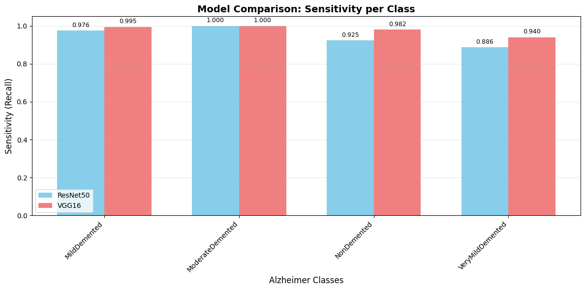
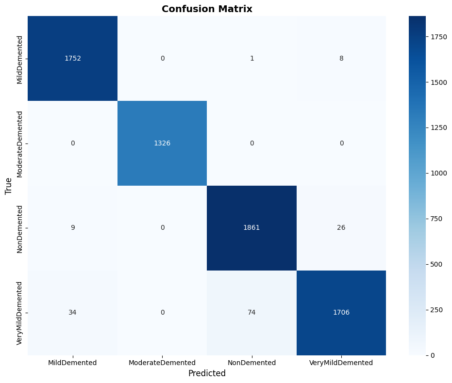
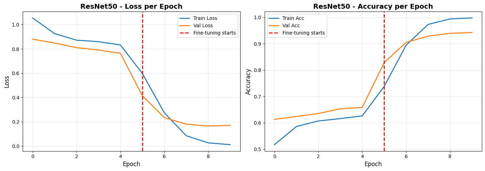
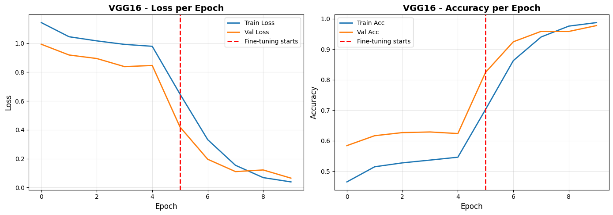

# Alzheimer's MRI Classification: ResNet50 vs VGG16

This project compares two ImageNet-pretrained CNNs, ResNet50 and VGG16, at sorting 2D brain MRI slices into four dementia stages. It uses transfer learning in PyTorch. Models are compared mainly on **sensitivity (recall)**, because a missed case of dementia costs more than a false alarm.

In the recorded run, **VGG16 scored higher on every metric**: 97.8% validation accuracy and 0.979 macro recall, against 94.3% and 0.947 for ResNet50. Read the [caveats](#caveats) before quoting these numbers. They come from one unseeded run on a validation set that is probably optimistic.

| File | What it is |
|---|---|
| `ann.ipynb` | The notebook, with outputs from the reported run. The run happened before the split was seeded. |
| `ann.py` | The same code exported as a script |
| `figures/` | Plots from the reported run, saved from the notebook |
| `requirements.txt` | Pinned dependencies |

## Data source

**[Augmented Alzheimer MRI Dataset](https://www.kaggle.com/datasets/uraninjo/augmented-alzheimer-mri-dataset)** (Kaggle, uploaded by uraninjo). It was made by augmenting the [Alzheimer's Dataset (4 class of Images)](https://www.kaggle.com/datasets/tourist55/alzheimers-dataset-4-class-of-images), which has about 6,400 original slices.

The download has two folders:

- `AugmentedAlzheimerDataset/` holds 33,984 augmented images. **This is the only folder used for training and evaluation.**
- `OriginalDataset/` holds the source images. It is not used.

| Class | Images in `AugmentedAlzheimerDataset/` |
|---|---:|
| MildDemented | 8,960 |
| ModerateDemented | 6,464 |
| NonDemented | 9,600 |
| VeryMildDemented | 8,960 |
| **Total** | **33,984** |

Check the Kaggle page for license and usage terms before you redistribute the data or the trained weights.

## Train/validation split

- **Method:** `torch.utils.data.random_split` makes an 80/20 split at the image level across all 33,984 images. It is not stratified, and it ignores which source scan each augmented image came from.
- **Sizes:** 27,187 training images and 6,797 validation images.
- **No test set:** The validation set picks the best checkpoint *and* produces the reported metrics.
- **Seeded:** The split now uses a seeded generator (`SEED = 42` in the config cell), so every run gets the same split.
- **Reported run used an unseeded split:** The run behind the numbers below happened before the seed was added. Its split can't be recovered, so a new run won't reproduce that exact split. In that run, the validation set held:

  | Class | Validation images |
  |---|---:|
  | MildDemented | 1,761 |
  | ModerateDemented | 1,326 |
  | NonDemented | 1,896 |
  | VeryMildDemented | 1,814 |

## Method

- **Preprocessing:** Each image is resized to 224×224, converted to RGB and normalized with ImageNet mean and standard deviation. No augmentation happens during training because the dataset is already augmented. If an image can't be read, a black image is used in its place and a warning is printed.
- **Models:** Both use an ImageNet-pretrained backbone from `torchvision`.
  - **ResNet50:** The `fc` layer is replaced with a new head.
  - **VGG16:** Only the last classifier layer (`classifier[6]`) is replaced, so the two 4096-unit layers before it are kept.
  - **New head:** `Linear(in, 512) → ReLU → Dropout(0.3) → Linear(512, 4)`.
- **Training:** Both models train in two phases with cross-entropy loss and a batch size of 64.
  1. **Feature extraction (5 epochs):** The backbone is frozen and only the new head trains. Optimizer: Adam, learning rate 1e-3.
  2. **Fine-tuning (5 epochs):** All layers are unfrozen. Optimizer: Adam, learning rate 1e-5.
- **Checkpoints:** After each epoch, the weights with the best validation accuracy so far are saved to `best_<model>.pth`. The weights after the final epoch are saved to `alzheimer_<model>_final.pth`.

## Reproducing

### 1. Set up the environment

The run used Python 3.12.3.

```bash
python -m venv .venv
# Windows
.venv\Scripts\activate
# macOS / Linux
source .venv/bin/activate

pip install -r requirements.txt
```

On Windows, the `torch==2.9.1` wheel from PyPI runs on CPU only. To train on a GPU, first install the CUDA builds of `torch` and `torchvision` using the command from [pytorch.org](https://pytorch.org/get-started/locally/), then install the rest of the requirements.

### 2. Get the data

Download the dataset from the Kaggle page, or use the [Kaggle CLI](https://github.com/Kaggle/kaggle-api):

```bash
kaggle datasets download -d uraninjo/augmented-alzheimer-mri-dataset -p data --unzip
```

The class folders must end up at this path, because the code expects it:

```
data/
└── AugmentedAlzheimerDataset/
    ├── MildDemented/
    ├── ModerateDemented/
    ├── NonDemented/
    └── VeryMildDemented/
```

`data/` is in `.gitignore`.

### 3. Run

Run everything from the repository root, because `DATA_DIR` is resolved relative to the current working directory.

- **Notebook:** Open `ann.ipynb` in VS Code or Jupyter and run all cells. `ipykernel` is in the requirements. For the browser interface, also run `pip install notebook`.
- **Script:** Run `python ann.py`. Each plot opens in a window and pauses the script until you close it.

On the first run, `torchvision` downloads the ImageNet weights: about 100 MB for ResNet50 and about 530 MB for VGG16.

The recorded run trained **on CPU**. ResNet50 took about 12 hours and VGG16 about 35 hours. A GPU is much faster. If more than one GPU is present, the models are wrapped in `nn.DataParallel`, so the keys in the saved `state_dict` start with `module.`.

Your numbers will differ somewhat from those below, for two reasons:
- Your split comes from the fixed seed, not from the reported run's unseeded split.
- The head initialization and the batch order are still unseeded.

## Results

All numbers come from the 6,797-image validation set of the recorded run, as stored in `ann.ipynb`. The models were evaluated after the final fine-tuning epoch. For both models, that epoch also had the best validation accuracy.

### Overall

| Model | Accuracy | Macro recall | Macro precision | Macro F1 |
|---|---:|---:|---:|---:|
| ResNet50 | 0.9425 | 0.9468 | 0.9462 | 0.9462 |
| **VGG16** | **0.9776** | **0.9792** | **0.9794** | **0.9792** |

### Per class

| Class | ResNet50 precision | ResNet50 recall | ResNet50 F1 | VGG16 precision | VGG16 recall | VGG16 F1 |
|---|---:|---:|---:|---:|---:|---:|
| MildDemented | 0.9222 | 0.9761 | 0.9484 | 0.9760 | 0.9949 | 0.9854 |
| ModerateDemented | 0.9977 | 1.0000 | 0.9989 | 1.0000 | 1.0000 | 1.0000 |
| NonDemented | 0.9379 | 0.9246 | 0.9312 | 0.9613 | 0.9815 | 0.9713 |
| VeryMildDemented | 0.9268 | 0.8864 | 0.9062 | 0.9805 | 0.9405 | 0.9600 |

For both models, **VeryMildDemented** has the lowest recall. This is the earliest stage and the hardest to tell apart from NonDemented.



### Confusion matrices

| ResNet50 | VGG16 |
|---|---|
|  |  |

In both matrices, rows are the true class and columns are the predicted class. Most errors are confusions among MildDemented, VeryMildDemented and NonDemented. Every ModerateDemented case is classified correctly.

The most costly error is labeling a dementia case as NonDemented. ResNet50 made that error 116 times and VGG16 75 times. Most of these were VeryMildDemented cases: 108 for ResNet50 and 74 for VGG16.

### Validation accuracy by epoch

| Epoch | Phase | ResNet50 | VGG16 |
|---:|---|---:|---:|
| 1 | Frozen backbone | 0.6132 | 0.5841 |
| 2 | Frozen backbone | 0.6240 | 0.6166 |
| 3 | Frozen backbone | 0.6353 | 0.6267 |
| 4 | Frozen backbone | 0.6531 | 0.6288 |
| 5 | Frozen backbone | 0.6584 | 0.6237 |
| 6 | Fine-tuning | 0.8282 | 0.8245 |
| 7 | Fine-tuning | 0.9051 | 0.9245 |
| 8 | Fine-tuning | 0.9288 | 0.9587 |
| 9 | Fine-tuning | 0.9394 | 0.9584 |
| 10 | Fine-tuning | 0.9425 | 0.9776 |

With a frozen backbone, accuracy levels off at about 62–66%. ImageNet features alone don't separate these classes well, and almost all of the gain comes from fine-tuning. By the last epoch, training accuracy reached 0.9977 for ResNet50 and 0.9874 for VGG16.

In the plots below, epochs are numbered from 0, and the dashed line marks the start of fine-tuning.





In ResNet50's last epoch, validation loss rose slightly (0.1649 → 0.1694) while training loss kept falling toward zero. This suggests it had started to overfit. VGG16's validation loss was still going down at the last epoch.

### Caveats

- **Data leakage is likely.** The augmented images are variations of a much smaller set of source slices. The split is random at the image level, so variants of the same source slice can land in both the training and validation sets. The validation set therefore probably overstates how well the models would do on scans they have truly never seen. A split grouped by source image (or by patient) would give a more honest estimate. Using `OriginalDataset/` as a test set doesn't fix this, because those images are the sources the augmented images were made from.
- **There is no independent test set.** The validation set chose the checkpoints and also produced the reported numbers.
- **This is a single, unseeded run** with no repeats and no confidence intervals. VGG16's lead is consistent across classes, but one run can't show how much of that lead would hold up across different splits.
- **This is a research and learning project, not a diagnostic tool.**
